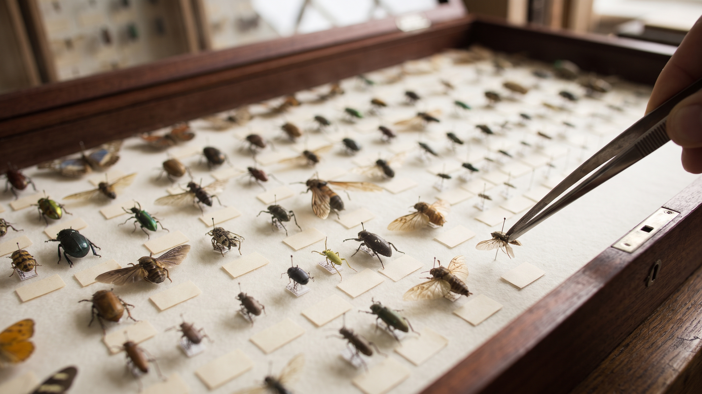
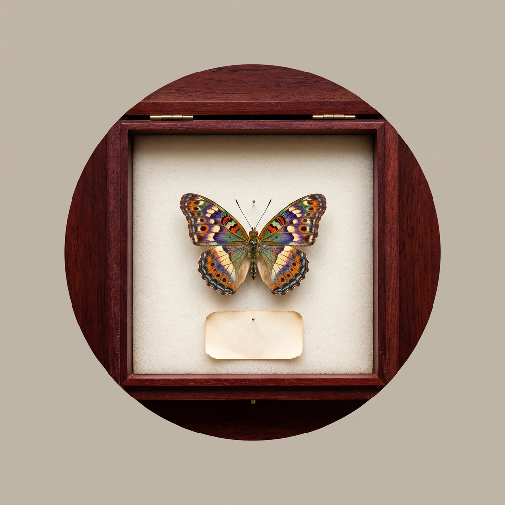
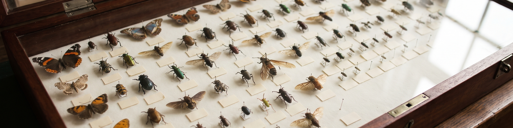

# Quote-Scraper

Scrapes Quotes from http://quotes.toscrape.com and exports them to a csv file updated every 5 minutes

# Warning:

quotes.csv does not need to exist before running: the script opens it in append mode, which creates the file if it is missing. The script never reads the file back and has no duplicate check, so a later run can append a quote that is already in the file.

